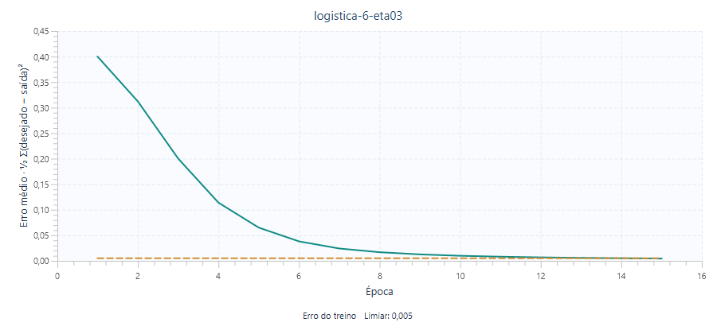
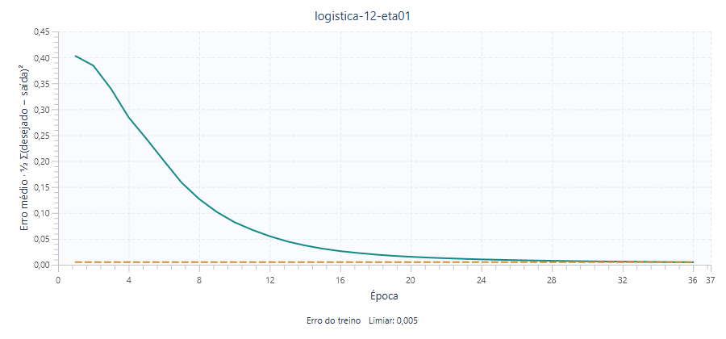
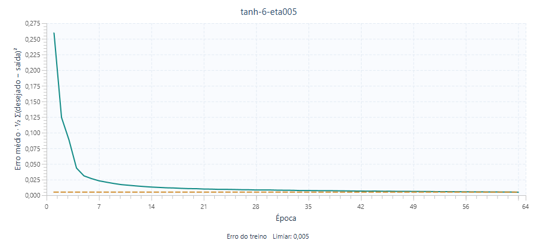

# Experimentos com a rede MLP

Base: 6 atributos numéricos, 5 classes, 827 amostras de treino e 352 de teste. Normalização min-max ajustada apenas no treino e alvos one-hot.

Resultados medidos pelo programa, com implementação própria de forward e backpropagation. Bases: `entradas/base_treinamento.csv` e `entradas/base_teste.csv`. O teste é usado apenas para avaliar a rede ao final de cada treinamento; não participa da normalização nem da atualização dos pesos.

Todos os experimentos usam semente 42, embaralhamento determinístico, até 2.000 épocas e erro mínimo 0,005. O erro da curva é a média do erro quadrático E retornada por cada época de treinamento. A acurácia é a fração de previsões corretas na base de teste.

| Experimento | Ativação | Ocultos | Taxa | Épocas | Erro final | Acurácia de teste | Platôs |
|---|---|---:|---:|---:|---:|---:|---:|
| logistica-6-eta03 | Logística | 6 | 0.30 | 15 | 0.00450694 | 100.00% (352/352) | 0 |
| logistica-12-eta01 | Logística | 12 | 0.10 | 36 | 0.00488990 | 100.00% (352/352) | 0 |
| tanh-6-eta005 | Tangente hiperbólica | 6 | 0.05 | 63 | 0.00483498 | 100.00% (352/352) | 0 |

## Tratamento de platô

O detector usa uma janela de 10 erros e limiar de desvio-padrão 0,00001. Neste executor automático, cada detecção é registrada e o treino continua com a mesma taxa de aprendizagem, pesos e dados. Apenas a janela do detector é reiniciada. Não há decisão interativa na CLI; na interface gráfica o usuário pode escolher continuar, reduzir a taxa em 10% ou parar.

## Curvas e arquivos completos

### logistica-6-eta03

Parada: Erro mínimo atingido. Detecções de platô: nenhuma.

| Real / Prevista | CA | CB | CC | CD | CE |
|---|---:|---:|---:|---:|---:|
| CA | 56 | 0 | 0 | 0 | 0 |
| CB | 0 | 53 | 0 | 0 | 0 |
| CC | 0 | 0 | 102 | 0 | 0 |
| CD | 0 | 0 | 0 | 75 | 0 |
| CE | 0 | 0 | 0 | 0 | 66 |

[Histórico CSV](../experimentos/logistica-6-eta03/historico.csv), [matriz de confusão CSV](../experimentos/logistica-6-eta03/matriz.csv) e [configuração e métricas JSON](../experimentos/logistica-6-eta03/resultados.json).

### logistica-12-eta01

Parada: Erro mínimo atingido. Detecções de platô: nenhuma.

| Real / Prevista | CA | CB | CC | CD | CE |
|---|---:|---:|---:|---:|---:|
| CA | 56 | 0 | 0 | 0 | 0 |
| CB | 0 | 53 | 0 | 0 | 0 |
| CC | 0 | 0 | 102 | 0 | 0 |
| CD | 0 | 0 | 0 | 75 | 0 |
| CE | 0 | 0 | 0 | 0 | 66 |

[Histórico CSV](../experimentos/logistica-12-eta01/historico.csv), [matriz de confusão CSV](../experimentos/logistica-12-eta01/matriz.csv) e [configuração e métricas JSON](../experimentos/logistica-12-eta01/resultados.json).

### tanh-6-eta005

Parada: Erro mínimo atingido. Detecções de platô: nenhuma.

| Real / Prevista | CA | CB | CC | CD | CE |
|---|---:|---:|---:|---:|---:|
| CA | 56 | 0 | 0 | 0 | 0 |
| CB | 0 | 53 | 0 | 0 | 0 |
| CC | 0 | 0 | 102 | 0 | 0 |
| CD | 0 | 0 | 0 | 75 | 0 |
| CE | 0 | 0 | 0 | 0 | 66 |

[Histórico CSV](../experimentos/tanh-6-eta005/historico.csv), [matriz de confusão CSV](../experimentos/tanh-6-eta005/matriz.csv) e [configuração e métricas JSON](../experimentos/tanh-6-eta005/resultados.json).

## Discussão

A maior acurácia observada nesta base de teste foi 100.00%, alcançada por 3 das 3 configurações. O experimento `logistica-6-eta03` precisou do menor número de épocas (15) para atingir o erro mínimo. A comparação usa uma única inicialização por configuração; portanto, os resultados não estimam a variabilidade entre sementes nem provam superioridade geral de uma ativação ou arquitetura. As duas configurações logísticas mudam simultaneamente a largura e a taxa, de modo que seus efeitos não podem ser atribuídos a um único fator.

Nas matrizes, as linhas representam as classes reais e as colunas as classes preditas. Os JSONs incluem precisão e revocação por classe para identificar confusões que a acurácia agregada pode ocultar.

Reprodução: `.\mvnw.cmd compile exec:java '-Dexec.mainClass=br.edu.mlp.cli.ExperimentRunner'`. Os PNGs são exportações de gráficos JavaFX Charts a partir dos históricos CSV.
